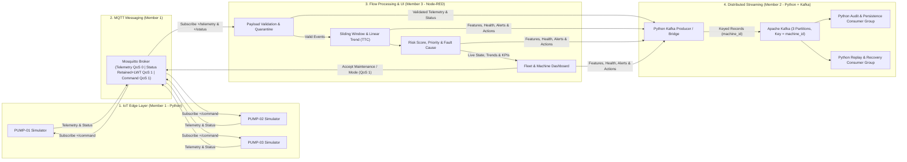

# IoT Predictive Maintenance for Industrial Motor-Pump Units

End-to-end distributed IoT application for real-time health monitoring, explainable fault detection, durable stream processing, and closed-loop maintenance orchestration across three virtual centrifugal water pump units (`PUMP-01`, `PUMP-02`, `PUMP-03`).

**Tech Stack:** Python Virtual Asset Simulator (`paho-mqtt`) · Eclipse Mosquitto (MQTT) · Node-RED (Flow Analytics & Dashboard) · Apache Kafka + Python Producers/Consumers

---

## 1. Problem & Overall System Architecture

Industrial rotating machinery (three-phase induction motors driving centrifugal water pumps) typically degrades gradually via bearing wear, cooling failure, or mechanical overload before catastrophic breakdown. Reactive maintenance causes costly unplanned downtime, whereas threshold-only alarms lack trend context, fault-cause attribution, and replayable audit history.

This project implements a decoupled, event-driven predictive maintenance pipeline that detects degradation early, estimates Time-to-Critical (TTC) when trends are statistically reliable, recommends targeted maintenance actions, and preserves immutable operational history.



### Component Roles & Architectural Rationale

| Component | Implementation | Architectural Role & Justification |
| :--- | :--- | :--- |
| **Virtual Asset Simulator** | Python (`simulator/`) | Models 3 motor-pump units (`PUMP-01..03`), 5 operating/fault modes, Gaussian noise, and gradual post-maintenance recovery via 3 independent MQTT client connections. |
| **MQTT Broker** | Eclipse Mosquitto | Lightweight pub/sub edge transport providing native Last Will and Testament (LWT) disconnect detection, retained device state, and low-overhead telemetry push. |
| **Flow Engine & UI** | Node-RED (`nodered/`) | Validates incoming JSON schemas, computes rolling-window trends (`TTC`), evaluates explainable health/risk scores, ranks fleet priority, and renders the live operator dashboard. |
| **Event Streaming** | Apache Kafka + Python (`kafka_streaming/`) | Python producers and independent Python consumer groups store append-only, immutable streams partitioned by `machine_id` for per-pump ordering, audit persistence, and offset replay. |

---

## 2. System Design & Interface Contracts

### 2.1 MQTT Topics, Last Will (LWT) & Payloads (`Member 1`)

All MQTT topics follow `factory/site01/machine/{machine_id}/...`:

| Topic | Direction | QoS | Retain | Justification |
| :--- | :--- | :---: | :---: | :--- |
| `factory/site01/machine/{machine_id}/telemetry` | Simulator -> Subscribers | `0` | `False` | Unified `1 Hz` sensor payload avoids multi-topic timestamp skew; non-retained so stale readings are never replayed as live ticks. |
| `factory/site01/machine/{machine_id}/status` | Simulator / Broker -> Subscribers | `1` | `True` | Carries online/offline connectivity, asset identity, and **Broker LWT**. `Retain=True` gives late-joining subscribers immediate fleet state. |
| `factory/site01/machine/{machine_id}/command` | Node-RED / CLI -> Simulator | `1` | `False` | Reliable downlink channel for `accept_maintenance`, `set_scenario`, `simulate_crash`, and `reconnect`. |
| `factory/site01/machine/all/command` | Node-RED / CLI -> Simulator | `1` | `False` | Broadcast control topic targeting all three virtual units simultaneously. |

- **Last Will and Testament (LWT) Design:** Each virtual pump connects with a dedicated `client_id` (`sim-PUMP-01..03`) and registers an LWT on `factory/site01/machine/{machine_id}/status` (`QoS 1`, `retain=True`) with payload `{"machine_id": "...", "connectivity": "OFFLINE", "machine_status": "OFFLINE", "reason": "unexpected_disconnect_lwt"}`. If a pump's TCP connection drops unexpectedly without a clean `DISCONNECT`, Mosquitto immediately broadcasts and retains its `OFFLINE` status while healthy pumps continue uninterrupted.

**Telemetry Payload (`/telemetry`):**
```json
{
  "machine_id": "PUMP-03",
  "timestamp": "2026-11-14T16:55:12.401Z",
  "seq": 48,
  "machine_status": "RUNNING",
  "temperature_c": 86.42,
  "vibration_rms": 7.65,
  "current_a": 13.84,
  "rpm": 1456,
  "sim_scenario": "BEARING_WEAR"
}
```
> **Validation Rule:** Consumers validate `machine_id`, `timestamp`, and numeric sensor fields (quarantining malformed messages). `sim_scenario` is ground-truth metadata for audit/validation only; fault detection relies strictly on the four sensor signals.

---

### 2.2 Node-RED Flows, Risk Scoring & TTC Decision Logic (`Member 3`)

| Signal | Normal Range | Warning Region | Critical Region | Risk Weight |
| :--- | :--- | :--- | :--- | :---: |
| `temperature_c` | `<= 70 C` | `70 - 80 C` | `> 80 C` | `30%` |
| `vibration_rms` | `<= 3 mm/s` | `3 - 6 mm/s` | `> 6 mm/s` | `40%` |
| `current_a` | `<= 15 A` | `15 - 20 A` | `> 20 A` | `20%` |
| `rpm` | `1400 - 1500 RPM` | `1350 - 1400` or `1500 - 1550` | `< 1350` or `> 1550` | `10%` |

- **Weighted Risk & Single-Signal Safety Floor:**
  - `weighted_risk = 0.30 * temp_anom + 0.40 * vib_anom + 0.20 * current_anom + 0.10 * rpm_anom` (`0..100`), `health_score = 100 - risk_score`.
  - State bands: `NORMAL (0-30)`, `WARNING (31-60)`, `CRITICAL (61-100)`, plus `OFFLINE` on LWT disconnect.
  - **Safety Override:** If any individual signal enters its `Warning` or `Critical` region, machine state is elevated to at least `WARNING` (`risk_score >= 35`) or `CRITICAL` (`risk_score >= 65`) so severe single-mode faults (e.g., pure overheating or overload) cannot be diluted below alarm thresholds.
- **Trustworthy Time-to-Critical (TTC):** Linear fit over a 20-sample smoothed window on the dominant degrading signal toward its critical limit; reported only when `samples >= 10` and `R^2 >= 0.70`, otherwise `Unknown` (labelled `estimated`).
- **Closed-Loop Action & KPI:** Operator acceptance publishes `{"command": "accept_maintenance"}` to MQTT `/command`, logs the action to Kafka, transitions the pump through smooth recovery, and updates the `ESTIMATED` avoided-cost KPI.

---

### 2.3 Kafka Topics, Partitions & Broker Replicas (`Member 2`)

Producers and consumers in the streaming layer are implemented in **Python** using **`machine_id` as the partition key**:

| Kafka Topic | Key | Partitions | Purpose |
| :--- | :--- | :---: | :--- |
| `machine.telemetry` | `machine_id` | `3` | Validated, normalized raw sensor telemetry stream |
| `machine.features` | `machine_id` | `3` | Rolling-window moving averages, slopes, and `R^2` metrics |
| `machine.health` | `machine_id` | `3` | Risk score, health score, state, TTC, and fleet priority updates |
| `machine.alerts` | `machine_id` | `3` | `WARNING` / `CRITICAL` / `OFFLINE` transitions and likely fault causes |
| `maintenance.actions` | `machine_id` | `3` | Recommended and operator-accepted maintenance actions |
| `machine.audit` | `machine_id` | `3` | Consolidated append-only operational history for audit and replay |

- **Justification of Partitions (`3` Partitions per Topic):** Matches the 3 monitored motor-pump assets (`PUMP-01..03`), enabling horizontal parallelism across up to 3 consumer instances within a consumer group while guaranteeing **strict per-machine chronological ordering** (`seq`) inside each partition via `machine_id` key hashing.
- **Justification of Broker Replicas:**
  - *Single-Broker Local Prototype (`replication-factor = 1`):* Minimizes memory footprint on a single lab workstation while preserving disk-backed log durability and offset replay.
  - *Fault-Tolerant Cluster Profile (`replication-factor = 2` or `3` across multi-broker Docker Compose):* Eliminates single-broker point of failure via leader/follower partition replication (`min.insync.replicas >= 2`), trading slight replication latency for high availability.

---

## 3. Message Delivery Semantics (`At-most-once` vs. `At-least-once` vs. `Exactly-once`)

| Layer & Channel | Chosen Semantics | Configuration | Justification |
| :--- | :--- | :--- | :--- |
| **MQTT `/telemetry`** | **At-most-once** | `QoS 0`, `retain=False` | High-frequency (`1 Hz`) periodic readings are immediately superseded by subsequent samples; fire-and-forget minimizes edge bandwidth and broker overhead. |
| **MQTT `/status` (incl. LWT) & `/command`** | **At-least-once** (+ Idempotent Consumer) | `QoS 1`, `PUBACK` retry; `accept_maintenance` deduplication | Critical connectivity alerts and maintenance commands cannot be lost. Duplicate `QoS 1` deliveries are safely absorbed by idempotent state handling in `VirtualPump`, avoiding the 4-way handshake latency of `QoS 2` (*exactly-once*). |
| **Kafka Producers & Consumers** | **At-least-once** | Producer `acks=all` (or `1` in 1-broker mode) + retries; Consumer offset committed after processing | Ensures zero silent loss of alerts, maintenance actions, or audit records. Downstream audit/replay consumers process keyed immutable events idempotently (keyed by `machine_id` + `seq`/`timestamp`), making heavyweight transactional *exactly-once* unnecessary. |

---

## 4. Repository Structure & Quickstart

```text
DIS/
├── simulator/          # [Member 1 - Ready] Python 3-pump simulator, MQTT QoS/Retain/LWT & CLI test suite
│   ├── config.py
│   ├── pump_model.py
│   ├── mqtt_worker.py
│   ├── run_simulator.py
│   ├── sim_cli.py
│   ├── test_simulator.py
│   ├── mosquitto/
│   └── README.md       # Detailed MQTT topic, LWT & delivery semantics guide
├── kafka_streaming/    # [Member 2] Kafka cluster compose, Python producers & consumer groups (audit/replay)
├── nodered/            # [Member 3] Node-RED flows & exported flow documentation
├── document/           # Project rules, syllabus, and proposal specifications
└── requirements.txt    # Python dependencies
```

See [`simulator/README.md`](./simulator/README.md) for standalone simulator, Mosquitto Docker, LWT crash test, and bad-payload test commands.

---

## 5. Conclusions (Benefits & Drawbacks) & Future Work

- **Benefits:**
  - **Edge-to-Core Decoupling:** Combines MQTT's lightweight IoT push and native LWT offline detection with Kafka's durable, partitioned event log and independent consumer replay.
  - **Explainable & Trust-Gated Decisions:** Links every alarm to its dominant physical signal, prevents noisy TTC extrapolations via `R^2 >= 0.70` gating, and closes the loop from anomaly detection to maintenance recovery.
- **Drawbacks & Prototype Limitations:**
  - Telemetry trajectories, thresholds, and avoided-cost KPIs (`ESTIMATED`) are controlled synthetic assumptions rather than certified manufacturer failure curves.
  - Running both Mosquitto and Kafka introduces higher operational complexity than a single-broker setup for small fleets of only three machines.
- **Future Work:**
  - Validate feature extraction and anomaly scoring against real accelerometer/RTD hardware (e.g., ESP32) or public run-to-failure bearing datasets (NASA/PRONOSTIA).
  - Add TLS/ACL broker authentication, Kafka Schema Registry (Avro/Protobuf), and multi-broker KRaft failover benchmarks.
